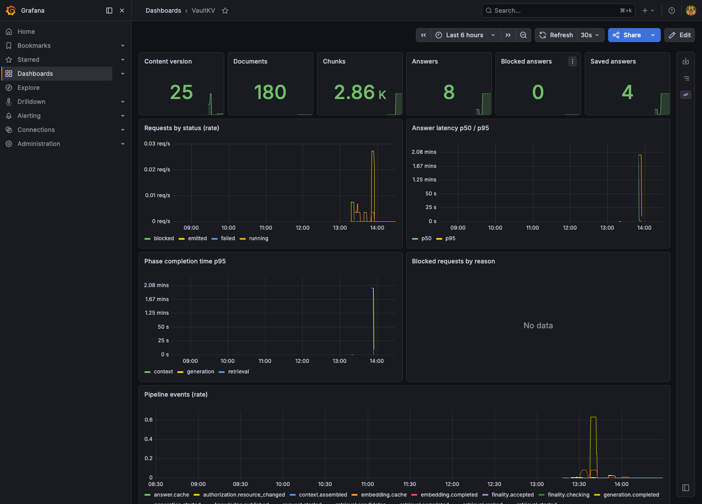

# VaultKV

[](https://github.com/Gustav-Proxi/VaultKV/actions/workflows/ci.yml)
[](LICENSE)

VaultKV is a transactional RAG control plane that pins requests to immutable knowledge snapshots
and rechecks current authorization before releasing buffered output. It combines BM25/vector
retrieval, local Ollama generation, document and group permissions, provenance, answer caching,
Prometheus metrics, OpenTelemetry hooks, and deterministic revocation race tests.

```sh
uv run vaultkv ingest --path examples/corpus --db data/local-demo.sqlite3
uv run vaultkv ask "What is the nightly hotel limit for domestic travel?" \
  --db data/local-demo.sqlite3 --top-k 2
```

See [local RAG setup and usage](docs/local-rag.md) for model installation,
permissions, ingestion, citations, and the real-model revocation check. The default
models are `qwen2.5:1.5b` and `nomic-embed-text:latest` on a local Ollama server.

## Production-style deployment



The Helm deployment runs the API and an Ollama sidecar, imports a read-only knowledge base on a
schedule, exposes health and readiness probes, and provisions Prometheus alerts plus a Grafana
dashboard. The API uses a trusted-gateway bearer token; document ACLs and the finality gate still
authorize every answer.

Measured on a 16 GB M4 MacBook using a local kind cluster with 4 vCPUs and 8 GB RAM:

| Workload | Result |
| --- | ---: |
| Private knowledge base | 180 documents / 2,859 chunks |
| First hybrid query | 11.6 min at ~4.4 embedded chunks/s |
| Later questions | 5–6 s |
| Exact repeated question | ~0.6 s |
| Test suite | 202 passing tests |

Running the real corpus exposed two bugs that synthetic fixtures missed:

- **Non-idempotent ingestion:** every scheduled import republished all 180 unchanged files, moved
  the knowledge epoch from 23 to 69, created 8,577 redundant chunk versions, and invalidated caches.
  Imports now compare content and access state before publishing; a second live import published
  zero documents.
- **Lost embedding progress:** embeddings were committed only after an entire request, so a timeout
  discarded several minutes of CPU work. Dense retrieval now checkpoints every 16 chunks.

The current 1.5B local model is intentionally modest. Retrieval usually finds the correct source,
but generation can still abstain or state a wrong fact; the deterministic CI gate measures
retrieval, authorization and finality rather than claiming answer correctness. See the complete
[deployment and evaluation notes](docs/deploy.md).

## Operator dashboard

```sh
uv run vaultkv serve --db data/local-demo.sqlite3 --open
```

Ask questions, import documents, manage users and reusable groups, inspect ranked
evidence, run safety checks, and download authorized VectorLens reports. Group
membership changes are applied to current and historical reads. CLI inspection
equivalents are `status`, `traces`, and `inspect`. See
[dashboard usage and trust boundaries](docs/dashboard.md).
An [experimental vLLM/LMCache prefix connector](docs/connectors.md) includes transfer guards,
diagnostics and a GPU smoke harness. This packaged connector still needs end-to-end GPU validation;
tensor metrics appear only when real worker transfers are recorded.

The original CPU consistency demos remain available:

```sh
uv sync --dev --locked
uv run vaultkv txn-demo
uv run vaultkv txn-races
uv run pytest
```

The demo shows a request completing against K=1 after K=2 is published, while a
separate mid-generation revocation blocks output. The controlled eight-barrier
race matrix reports 7 post-revocation emissions for retrieval-only checks, 3 for
retrieval plus cache checks, and 0 for the finality gate.

See [the TxnRAG guide](docs/txnrag.md) for usage, snapshot/deletion semantics,
authorization boundaries, and limitations. This is a keyed, extractive CPU
reference pipeline with synthetic cache bytes. The `ask` command uses the separate
real-model path; the experimental serving connector needs Linux CUDA validation.

## Upstream LMCache results

The repository also contains the reproductions and raw measurements behind three upstream findings:

- [LMCache PR #5584](https://github.com/LMCache/LMCache/pull/5584) fixes empty CacheBlend segments,
  restoring non-prefix hits and producing a 3.2× TTFT improvement on a 7B, 12k-token reorder test.
- [LMCache PR #5595](https://github.com/LMCache/LMCache/pull/5595) recomputes separator-gap KV instead
  of blending zero-filled rows, reducing visible artifacts from 8/8 to 0/8 without measurable TTFT
  cost.
- [LMCache issue #5596](https://github.com/LMCache/LMCache/issues/5596) documents incorrect causal
  masking for scattered recompute queries and proposes a paged-attention fix.

On 97 LongBench 2WikiMQA questions, both fixes reached F1 0.440 versus 0.456 for full recomputation.
For six paired full-hit prompts, median TTFT improved 2.28× over recomputation. Setup, limitations and
raw results are in [the real-RAG benchmark report](upstream/lmcache-3238/realrag/BENCHMARK_REAL.md).

## Original VaultKV core

The original API remains a **CPU-only local control plane** for version- and permission-consistent
chunk cache reuse. It implements SQLite metadata and opaque-byte cache storage,
admission checks, atomic invalidation, and guarded consumption. The research plan
is in [vaultkv.md](vaultkv.md).

**The original core remains a byte-cache reference.** Consistency-demo payloads are
synthetic bytes, not KV tensors. Ollama inference does not export KV tensors to
VaultKV. Edit-local repair, timing-attack mitigation, and research performance
results remain future work.

## Run locally

Requires Python 3.11+ and `uv`. No GPU, credentials, datasets, or runtime packages
are required.

```sh
uv sync --dev --locked
uv run vaultkv demo
uv run pytest
uv run ruff check .
uv run ruff format --check .
uv run python benchmarks/mutation_stream.py --steps 1000 --seed 42
```

The demo exercises cold/warm lookups, workspace isolation, revocation of a queued hit,
document edits, and deletion. The deterministic mutation workload checks outcomes
against an independent in-memory oracle; it is a correctness exercise, not a GPU
latency benchmark. Dependency versions are recorded in `uv.lock`.

## Use the core

```python
from vaultkv import CacheProfile, Identity, Ledger, Provenance, VaultCache

alice = Identity("acme", "alice")
profile = CacheProfile(
    model_revision="model@immutable-revision",
    tokenizer_revision="tokenizer@immutable-revision",
    kv_format="fp16:engine-layout-v1",
    context_hash="canonical-prefill-template-digest",
)

with Ledger("vaultkv.sqlite3") as ledger:
    cache = VaultCache(ledger)
    document = ledger.put_document(
        "acme",
        "handbook",
        {"intro": "Welcome to Acme"},
        expected_version=0,
        principals=[alice],
    )
    query = document.query("intro", alice)
    ticket = cache.publish(query, profile, Provenance(profile.context_hash), b"synthetic-kv")
    cache.consume(ticket, lambda payload: print(f"Consumed {len(payload)} bytes"))
```

Run this example against a new database. To edit an existing document, pass both
its current `expected_version` and `expected_epoch`, plus its complete chunks and
ACL. These optimistic checks prevent a stale editor from restoring revoked access.
`set_permissions` requires `expected_epoch`; `delete_document` requires
`expected_version`. Tombstones preserve monotonic versions across recreation.

## Decisions and sharing

| Decision | Caller action |
| --- | --- |
| `hit` | Schedule the ticket, then call `consume` to revalidate before use. |
| `miss` | Compute only from an authorized source; publication rechecks metadata. |
| `stale` | Refresh retrieval metadata and retry admission. |
| `denied` | Stop; never recompute or return the protected document. |

In the product UI, these choices are shown as **Workspace**, **This user**, and
**Everyone**. Internally, `tenant-shared` requires an explicit user access list
and matching workspace; an empty list denies everyone. `private` adds the user to
the cache key. `public`
allows all requesters to reuse that document's cache. Public reuse does not dedupe
separate documents. Keys include document/chunk identity, content hash, version,
policy epoch, sharing tier, and the model/tokenizer/context/format fingerprint.

Edits, deletion, or actual ACL changes atomically remove all cache entries for the
document. An unchanged ACL is a no-op. This prototype conservatively invalidates
instead of attempting tensor repair.

## Consistency and trust boundary

Admission is a scheduling hint, not a lease. `consume` rechecks authorization and
freshness inside a SQLite `BEGIN IMMEDIATE` transaction before loading bytes.
All mutations use the same database lock, including across connections. A
revocation becomes effective when its transaction commits; it waits for an active
consumer. This serializes consumption and prioritizes correctness over throughput.
SQLite errors propagate: storage failure never permits a cache hit.

Callbacks must complete protected computation and output synchronously before
returning. Do not retain payloads, dispatch async/GPU work, or reenter the ledger.
This API cannot revoke copied bytes or outputs returned later by an application.
Remote invalidation, streamed responses, and GPU synchronization need a separate
integration design.

All Python APIs, database access, producers, and caller identities are trusted.
An application must authenticate clients and derive `Identity` server-side.
Provenance checks reject mismatched context or nonzero position, but cannot prove
how supplied bytes were computed. Do not accept client-supplied cache payloads or
expose administration/publication APIs directly. This prototype does not establish
SpliceLeak/HijackKV resistance; a timing or tensor-contamination evaluation remains
future work. Deletion removes logical entries, not forensic remnants from SQLite.

## Layout and next integration steps

- `src/vaultkv/models.py`: immutable requests, profiles, tickets, and decisions.
- `src/vaultkv/ledger.py`: document lifecycle, ACL epochs, and transactions.
- `src/vaultkv/admission.py`: authorization and metadata-only cache lookup.
- `src/vaultkv/cache.py`: trusted publication and guarded byte consumption.
- `src/vaultkv/txnrag/`: knowledge snapshots, request/artifact contracts, current
  authorization, snapshot cache adapter, and final output gate.
- `tests/`: CPU tests for isolation, races, invalidation, persistence, and workloads.
- `benchmarks/`: deterministic synthetic mutation runner.

Before GPU integration, pin compatible vLLM/LMCache revisions, implement a trusted
canonical tensor producer, and define scheduler/worker fencing through output
completion. Test real position-independent tensor reuse and attack defenses before
claiming serving correctness or performance. GPU test and benchmark commands will
be added when that integration exists.
